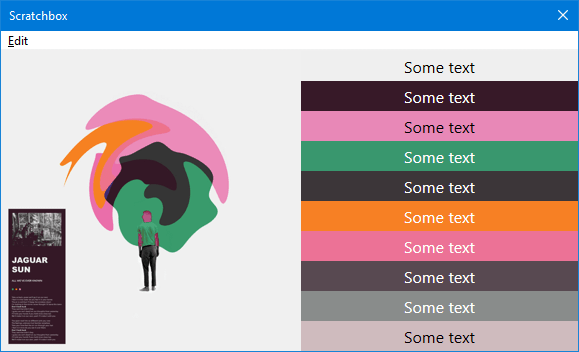

**Properties**

|||||
|---|---|---|---|
|Height|`number`|read|
|Path|`string`|read|This will the source path of the image when created from the various album art methods or [utils.LoadImage](../namespaces/utils.md#utilsloadimagepath-max_size). It will be empty if the image is cloned or created with [utils.CreateImage](../namespaces/utils.md#utilscreateimagewidth-height).|
|Width|`number`|read|

**Methods**

## `Clone()`
Returns a `JsImage` instance.

## `CreateBitmap()`
Return an [JsBitmap](JsBitmap.md) instance.

!!! example
	```js
	let g_bitmap = null;

	if (playback.IsPlaying) {
		update_bitmap();
	}

	function update_bitmap() {
		const handle = playback.GetNowPlaying();
		const image = handle?.GetAlbumArt(0); // 0 = front
		g_bitmap = image?.CreateBitmap();
	}

	function on_paint(gr) {
		if (g_bitmap) {
			gr.DrawBitmap(g_bitmap, 0, 0, g_bitmap.Width, g_bitmap.Height, 0, 0, g_bitmap.Width, g_bitmap.Height);
		}
	}
	
	function on_playback_new_track() {
		update_bitmap()
		window.Repaint();
	}
	```

See also: [utils.LoadBitmap](../namespaces/utils.md#utilsloadbitmappath-max_size).

## `FlipRotate(options)`
|Arguments|||
|---|---|---|
|options|[WICBitmapTransform](../flags.md#wicbitmaptransform)|

No return value.

## `GetColourScheme()`
Extracts up to 10 colours from the source image.

Returns an array.

!!! example
	=== "Code"
		```js
		'use strict';

		include('helpers');

		// Tracks playlist selection

		let img;
		let colours = [];
		on_item_focus_change();

		function on_item_focus_change() {
			const metadb = fb.GetFocusItem();
			img = metadb?.GetAlbumArt();
			colours = img?.GetColourScheme() || [];
			window.Repaint();
		}

		function on_paint(gr) {
			if (img && colours.length) {
				gr.DrawImage(img, 0, 0, 300, 300, 0, 0, img.Width, img.Height);

				colours.forEach((colour, i) => {
					gr.FillRectangle(300, i * 30, window.Width - 300, 30, colour);

					/*
					The 2nd WriteTextSimple arg is the font. Leaving it as an empty string so defaults of Segoe UI and 16px are used.

					See helpers.js in the component directory for the DetermineTextColour function
					which calculates whether to use black or white for the text colour depending on
					the background colour.
					*/
					gr.WriteTextSimple('Some text', '', DetermineTextColour(colour), 300, i * 30, window.Width - 300, 30, 2, 2);
				});
			}
		}

		function on_playlist_switch() {
			on_item_focus_change();
		}
		```
	=== "Result"
		

## `GetGraphics()`
Return an [JsGraphics](JsGraphics.md) instance.

## `ReleaseGraphics()`
No return value.

## `Resize(width, height)`
|Arguments|||
|---|---|---|
|width|`number`|
|height|`number`|

No return value.

## `SaveAs(path)`
|Arguments|||
|---|---|---|
|path|`string`|The parent folder must already exist. The image is saved as `JPG` so you should use that as the file extension.|

Returns a `boolean` value to indicate success.

## `StackBlur(radius)`
|Arguments|||
|---|---|---|
|radius|`number`|Valid values `2`-`254`.|

No return value.

!!! example
	```js
	include('helpers');

	const img = utils.LoadImage(fb.ComponentPath + 'test\\images\\1.webp');
	let blur_img = null;
	let radius = 20;

	StackBlur(radius);

	function StackBlur(radius) {
		blur_img = img.Clone();
		blur_img.StackBlur(radius);
	}

	function on_paint(gr) {
		gr.DrawImage(img, 0, 0, 550, 368, 0, 0, 550, 368);
		gr.DrawImage(blur_img, 0, 368, 550, 368, 0, 0, 550, 368);
		gr.FillRectangle(0, 0, window.Width, 24, RGB(0, 0, 0));
		gr.WriteText('Scroll mouse to change radius: ' + radius, '', RGB(255, 255, 255), 0, 0, window.Width, 24, 2, 0);
	}

	function on_mouse_wheel(step) {
		radius += step * 5;
		
		if (radius < 2)
			radius = 2;
		else if (radius > 254)
			radius = 254;
	
		StackBlur(radius);
		window.Repaint();
	}
	```
